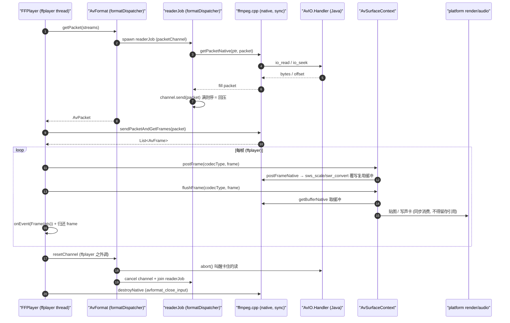

# cxx/ffmpeg — FFmpeg 自定义 AVIO + 解码 + 播放

桌面端（Windows）与 Android 共用的 FFmpeg 原生桥，用 C++ 实现 Kotlin 侧 `soko.ekibun.ffmpeg`
各类的 JNI 入口（`AvFormat` / `AvCodec` / `AvFrame` / `AvSurfaceContext` / `AvPacket`）。
整个模块只有一个翻译单元 `ffmpeg.cpp`：它把上游 ffmpeg 的 `libavformat` / `libavcodec` /
`libavutil` / `libswresample` / `libswscale` 包成「自定义 AVIO + 解封装 + 解码 + 软转码 + 取帧」
五段能力，视频转码目标固定 `AV_PIX_FMT_RGBA`。

本桥是 [`flutter_ffplay`](https://github.com/ekibun/flutter_ffplay) 在 Kotlin Multiplatform 上的后代：
同样的自定义 AVIO 思路、同样的 `sendPacketAndGetFrames` 解码节奏、同样的「主时钟对齐」播放模型；
差异在于没有 dart:ffi / method channel —— 全部走 JNI，且播放时序收在 Kotlin 协程里（见 §线程模型），
不是原生层的播放线程。

> 硬约束、构建坑、字节级实测全在 [`../AGENTS.md`](../AGENTS.md) 的 ffmpeg 一节；不报错只失效的
> 几类（两轮播放串帧、缓冲未回写、pb 二次关闭、读轮与销毁 UAF）逐项在
> [`../../.agents/skills/project-traps/references/silent-failures.md`](../../.agents/skills/project-traps/references/silent-failures.md)
> 与 [`http-streaming.md`](../../.agents/skills/project-traps/references/http-streaming.md)。
> 本文只讲架构与时序，不堆缺陷清单。

## 架构

### 模块构成

`ffmpeg.cpp` 暴露的能力与 Kotlin 侧类一一对应：

| JNI 面（Kotlin） | native 职责 |
|---|---|
| `AvFormat` | 自定义 `AVIOContext`（`io_open` / `io_read` / `io_seek` 回调到 Java 的 `AvIO.Handler`）、解封装（`avformat_open_input` / `av_read_frame`）、容器级 seek |
| `AvCodec` | 按流建解码器，`sendPacketAndGetFrames` 一次把整批帧收回来（含 `flush` drain 尾帧） |
| `AvFrame` | 包裹 `AVFrame`，持有 native 侧那一帧的所有权，关闭即 `av_frame_free` |
| `AvSurfaceContext` | `SWContext`：按流类型缓存 `SwsContext` / `SwrContext` 并持有**复用输出缓冲**；`postFrame` 软转码、`flushFrame` 把字节交给平台 |
| `AndroidSurfaceContext` | 把 RGBA 缓冲 `copyBufferToSurface` 到 `android.view.Surface`（Android 专属入口） |

上游 ffmpeg 整棵源码树（`cxx/ffmpeg/ffmpeg/`）是 **git submodule**，只编译不修改；
配置与链接由 `ffmpeg.cmake` 经 `ExternalProject` 完成（桌面开 x86 asm，Android 关，理由见 `AGENTS.md`）。

### 线程模型

**native 侧没有任何线程**——`ffmpeg.cpp` 全是同步 JNI 调用，在哪个 Kotlin 线程上被调就在哪条线程上跑。
时序由 Kotlin 的 `ThreadDispatcher`（见 `platform/.../Binding.kt` 的 `Pointer.withPtr` / `withPtrSync`）
在三条固定线程上编排：

| 线程 | 归属 | 职责 |
|---|---|---|
| `avformat` | `AvFormat`（即 `Pointer` 的 `dispatcher`） | demux 上下文的所有 native 调用；`getPacket` 内部起一条**后台读作业**（`readerJob`），跑在 `formatDispatcher` 上，通过 `packetChannel`（容量 `PREFETCH_PACKETS`）把包预读出来供消费侧取 —— 这是回压与「暂停期预读」的载体 |
| `ffplayer` | `FFPlayer`（伴生对象懒加载，全进程共用，**不关闭**） | 播放时序的唯一归属：取包、投解码、按主时钟送显/送声卡全在这条线程上串行，**读 `pts` 与随后的检查必须落在同一段不被打断的序列里** |
| 平台渲染线程 | `AvSurfaceContext` 的子类（`SurfaceContext.jvm.kt` / `.android.kt`） | `flushFrame` 之后的贴图 / 写声卡，由平台实现决定 |

`Pointer` 的 `withPtr` 把整段调用搬到归属线程（`dispatcher`）上跑；`withPtrSync` 是给 native
回调链用的同步路径（`@Keep` 的函数由 native 线程直接调进来，那里没有协程上下文）。所以「调用方线程」
与「实际碰 runtime / 碰 ffmpeg 上下文的线程」可能不同，但**永远是归属线程**。

### 缓冲与所有权

- **输出缓冲按流类型复用**：`SWContext` 对视频 / 音频各保一块输出数组，`postFrame`（sws_scale /
  swr_convert）就地覆写它，`flushFrame` 才把内容交给平台。所以调用方**必须同一次调用里同步消费**
  这块数组，下一帧会原地把上一帧内容盖掉（Kotlin 侧 `AvSurfaceContext.buffers` 同样按 `codecType`
  复用、对不上长度才重建）。要留住内容自己拷一份。
- **`AvFrame` 所有权**：native 侧把一帧的所有权交给 Java 后，归还由 Kotlin 收口——`FFPlayer` 用
  `frame.processing` 标记「是否被本轮取走」，未消费的帧在作业完成（`invokeOnCompletion`）时**还回队列**
  而非出队（`remove()` 的返回值不能当判据，踩过）；轮次停下时留在队列里的帧由 `closeAsync` 统一归还。
- **`AvPacket` 所有权**：包经 `packetChannel` 移交，通道用 `onUndeliveredElement` 兜底归还
  （没被收走的包不漏）；`EOF` / 读出错的包在 native 读循环里就地 `close()`，API 层拿不到的包不会悬空。
- **`AvIO.Handler.open` 不许抛异常**：它跑在 native 的 `io_open` 回调里，Kotlin 异常会 pending 在
  JNI 上没人接，下一个 JNI 调用直接 abort 整个 JVM。打不开就返回 read/seek 恒失败的 IO（见 `AGENTS.md`）。

### 典型数据流（一帧的播放路径）

```
FFPlayer.resumeImpl (ffplayer 线程)
  ├─ 后台读作业 (formatDispatcher): AvFormat.getPacket → native getPacketNative
  │     → AvIO.read/seven (Java, 卡在原生 av_read_frame 里, 协程取消对它无效)
  │     → 通过 packetChannel 把包交给消费侧 (容量满则停 send 等消费 = 回压)
  ├─ AvCodec.sendPacketAndGetFrames(packet) → native: avcodec_send_packet + receive_frame 整批
  │     → 必要时 sws/swr 已在 AvSurfaceContext 一侧, 不在解码这一步
  └─ 每流一个 updateJob (ffplayer):
        surfaceContext.postFrame(codecType, frame) → native SWContext: sws_scale / swr_convert 就地覆写输出缓冲
        surfaceContext.flushFrame(codecType, frame) → getBufferNative 取缓冲 → 平台贴图/写声卡
        onEvent(Frame(pts)) 回调; 帧归还 (processing 清空 / close)
```

主时钟是 `FFPlayer.PTS`：用**单调时钟**测「过了多久」（墙钟会被 NTP 校时拨动，突跳一格画面就是快进或干等），
音频帧会把 `relate` 校正到实际重采样时间戳。seek 必然落关键帧（容器物理限制），「平滑」靠两步：
先把主时钟拨到目标，再丢掉关键帧→目标之间的帧（`resyncTo` 收敛，对应 ffplay 的 `frame_drops_early`）。

## 时序图



## 相关文档

- ffmpeg 硬约束（RGBA 钉死、asm 差异、缓冲缓存键回写、pb 账本、AvIO 禁忌、EAGAIN/drain）：[`../AGENTS.md`](../AGENTS.md) 的 ffmpeg 一节
- 不报错只失效逐项：`[../../.agents/skills/project-traps/references/silent-failures.md](../../.agents/skills/project-traps/references/silent-failures.md)`
- 自定义 AVIO 与读轮作废顺序：`[../../.agents/skills/project-traps/references/http-streaming.md](../../.agents/skills/project-traps/references/http-streaming.md)`
- 原生构建 / `buildJni` / dll 落位：`[../AGENTS.md](../AGENTS.md)` 的「原生构建」一节
- 上游设计参照：[`flutter_ffplay`](https://github.com/ekibun/flutter_ffplay)
