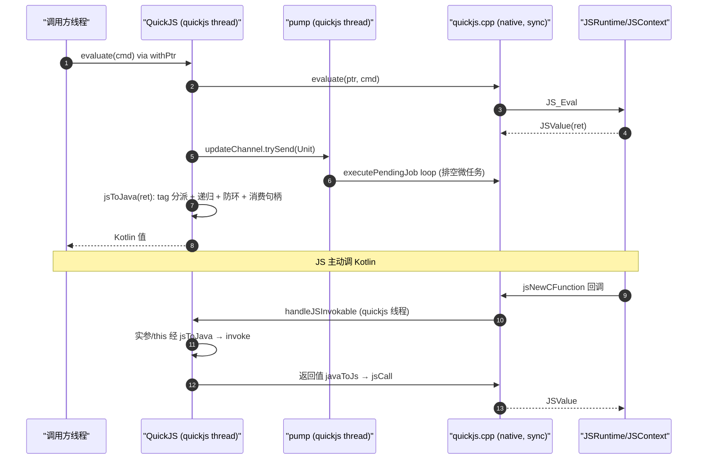

# cxx/quickjs — QuickJS 引擎桥

桌面端（Windows）与 Android 共用的 QuickJS 原生桥，用 C++ 实现 Kotlin 侧 `soko.ekibun.quickjs`
各类的 JNI 入口（`QuickJS` / `JSRef` / `JSFunction` / `JSError`）。整个模块只有一个翻译单元
`quickjs.cpp`，外加编译进同一动态库的 QuickJS 本体（`quickjs.c` / `cutils.c` / `libregexp.c` /
`libunicode.c` / `dtoa.c` / `unicode_gen.c`）。它把 `JSRuntime` + `JSContext` 包成可被 Kotlin
直接持有的句柄，并提供 Java ↔ JS 双向互操作、Promise 承接（`Deferred`）、模块加载回调。

本桥是 [`flutter_qjs`](https://github.com/ekibun/flutter_qjs) 在 Kotlin Multiplatform 上的后代：
同样的 `JS_TAG_*` 类型分派口径、同样的 `jsToJava` / `javaToJs` 互操作思路、同样的「关闭前清算泄漏」；
差异在于没有 dart:ffi / isolate 事件循环——所有 native 调用串行在一条 Kotlin 线程上（见 §线程模型），
`import()` / `require()` 被禁用（能力内联进 `init.js`），且引用计数规则由专设的 skill 接管。

> 所有权模型是显式引用计数，完整规则见
> [`../../.agents/skills/quickjs-ownership/references/quickjs-reference-ownership.md`](../../.agents/skills/quickjs-ownership/references/quickjs-reference-ownership.md)
> （或触发 skill `quickjs-ownership`）。动 `JS_FreeValue` / `JS_DupValue` / `definePropertyValue` 之前先读它。
> 本文只讲架构与时序，不堆规则清单。

## 架构

### 模块构成

`quickjs.cpp` 在 QuickJS 本体之上补了三样东西：

- **`JSRuntimeOpaque`**：挂到 `JS_GetRuntimeOpaque`，存 `JavaVM*`、runtime 对应的 Kotlin
  `QuickJS` 弱全局引用、以及 `javaClassID`（`JS_GetOpaque` 还原 Java 对象时用的 class id）。
- **`JavaObject` 类**：由 `jsWrapObject` 创建——把任意 Java 对象（`AutoCloseable` 等）包成 JS 对象，
  析构回调里替 JS 调 `close()`，让 native 侧能回收它。
- **模块加载回调**：native 在 `import()` 触发的加载点调回 Kotlin 的 `loadModule(name)`，返回模块源码
  字符串；找不到返回 null。

编译时开 `-DDUMP_LEAKS`：关闭 runtime 时把仍登记在册的对象打印到标准错误流（见 §所有权）。

### 线程模型

**native 侧没有任何线程**——`quickjs.cpp` 全是同步 JNI 调用。全部 native 调用串行在一条 Kotlin 线程上：

| 线程 | 归属 | 职责 |
|---|---|---|
| `quickjs` | `QuickJS.sharedDispatcher`（全进程共享、`ThreadDispatcher("quickjs")`、`从不 shutdown`） | runtime 的所有 native 调用：`evaluate` / `jsCall` / 类型转换 / 引用归还，全经 `Pointer.withPtr` / `withPtrSync` 投到这条线程串行执行 |
| （同一条） | `QuickJS` 构造时起的 pump 协程 | 监听 `updateChannel`：每次 `evaluate` / `jsCall` 之后 `trySend(Unit)`，pump 在归属线程上 `executePendingJob` 把 Promise 的微任务排空 |

共享的代价：所有 runtime 在这条线程上**串行**——一个 runtime 跑长任务（或卡在 `timeout` 边界上）
会拖住别的 runtime。要独占就显式传一条 `ThreadDispatcher("quickjs-xxx")`。JS 回调
（`handleJSInvokable` / `loadModule`，`@Keep` 标的方法）由 native 线程直接调进来，落在的正是这条
归属线程——所以回调里再建一个 runtime 不会死锁（构造本身不切线程），但在回调里**等**它的结果就是
自己等自己。`QuickJS` 实例句柄是惰性的：首次读句柄才在归属线程上 `initContext`（那一步
`JS_NewRuntime` 会把调用线程帧地址记成 `stack_top`，依赖不能丢）。

### 所有权与引用计数

- **双句柄，别混用**：`QuickJS` 持有的是 **runtime/context 句柄**（`ctx`），`JSRef` 持有的是
  **单个 JS 值句柄**（`value`）。两者都是 `Long`，混用就是拿 runtime 指针对去 `jsFreeValue`，
  当场踩坏 native 堆（实测 `0xC0000374` heap corruption 直接死）。
- **`refs` 强引用登记册**：`QuickJS` 把所有仍持有 native 引用的 `JSRef` 按**对象身份**（`HashSet`，非指针）
  登记。身份登记让 `close()` 能确定性地逐个归还、并枚举出残留者——这是本类不设 GC 兜底（Android
  `minSdk = 24` 没有 `Cleaner`）的底气。
- **关闭前清算**：`releaseImpl` 先 `updateChannel.close()` 停 pump，再 `collectLeaks()`（**先记录仍
  在册者 = 泄漏清单，再逐个 `closeDeferred().join()` 归还**），最后 `destroyContext`。顺序承重：归还前必须
  抓下泄漏，否则 `JS_FreeRuntime` 的 `gc_obj_list` 断言直接 `abort()` 整个进程。
- **`definePropertyValue` 无条件消费 `val` 引用**：调用方不要再减一次（历史上漏了会改错）；
  native 另有粒度 helper（`jsReleaseValue` / `jsDestroyHandle`）给「只要其一」的场合，不过 JNI 界。
  `jsToJava` 是**唯一**的对象/标量分发点，消费掉入参句柄——递归点必须走它，否则碰到的对象会静默变 null。

### Java ↔ JS 互操作

- **`jsToJava`（JS → Java）**：tag 名字沿用 QuickJS 的 `JS_TAG_*`，**数值是 C 侧映射的返回值**（原始 tag 不出
  native，避免随构建配置变形的 `FLOAT64` 判据 ABI 化）。`ArrayBuffer` 探针在最前（按 class id 自标定过滤，
  非 ArrayBuffer 给 null 不抛）；`JSInvokable` 展开成 `JSFunction`（dup 出的独占新票归拿到的人）；
  `Promise` 包成 `Deferred`（一次遍历内同一 promise 给同一 `Deferred`）；普通对象整图展开成
  `LinkedHashMap`（属性序 = 插入序）。**每次顶层调用新建一张 `cache`（按 native 指针），函数不登记**
  （登记会制造共享、导致读已析构 JSValue 的失效）—— 三条规则对齐上游 `_jsToDart`。
- **`javaToJs`（Java → JS）**：`cache` 是**按对象身份的 `IdentityMap`**（常数哈希 + `===` 比对），用来切断
  循环引用（`a["a"] = a` 不无限递归、且两处同一容器不折叠）。`Deferred` → `jsNewPromise` + resolve/reject
  回调；`Throwable` → JS `Error`（name/message/stack）；`JSInvokable` → `jsNewCFunction` + `jsWrapObject`。
  返回的全是「新建 或 jsDupValue 出来的新引用」，调用方用 `try/finally` 保证归还。

### 典型数据流

```
evaluate(cmd)  (调用方线程)
  → Pointer.withPtr: 整段求值搬到 quickjs 线程
  → native evaluate → executePendingJob 排空微任务 (pump)
  → jsToJava: tag 分派 + 递归 + 防环 + 消费句柄
  → 结果回调用方 (Kotlin 值)

JS 调 Kotlin:
  JS 函数调用 → native jsNewCFunction 回调 → handleJSInvokable (quickjs 线程)
  → 实参/this 经 jsToJava → obj.invoke(...) → 返回值经 javaToJs 变句柄回 C
```

## 时序图



## 相关文档

- 引用计数完整规则（消费/持票/防环/线程归属）：[`../../.agents/skills/quickjs-ownership/references/quickjs-reference-ownership.md`](../../.agents/skills/quickjs-ownership/references/quickjs-reference-ownership.md)
- 能力桥（`JavaObject` / `jsWrapObject` 析构回收）：`[../../.agents/skills/quickjs-ownership/references/ability-bridge.md](../../.agents/skills/quickjs-ownership/references/ability-bridge.md)`
- `import()` / `require()` 禁用与 `init.js` 内联：`[../../.agents/skills/project-traps/references/silent-failures.md](../../.agents/skills/project-traps/references/silent-failures.md)`
- QuickJS 硬约束（tag、`@JvmStatic` 与 `thiz`、包名即符号）：[`../AGENTS.md`](../AGENTS.md) 的 quickjs 一节
- 原生构建 / `buildJni` / dll 落位：`[../AGENTS.md](../AGENTS.md)` 的「原生构建」一节
- 上游设计参照：[`flutter_qjs`](https://github.com/ekibun/flutter_qjs)
