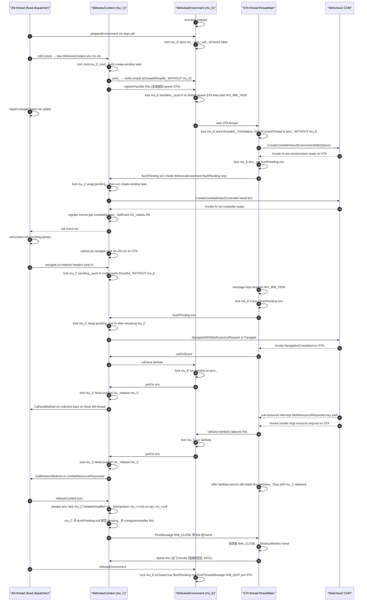

# cxx/webview — WebView2 原生宿主

桌面端（Windows）的 WebView2 原生宿主，用 C++ 实现 Kotlin 侧 `soko.ekibun.web.Webview2Context`
与 WebView2 / COM 之间的 JNI 桥。整个模块只有一个翻译单元 `webview.cpp`：它既承载环境单例
（`WebviewEnviorment`）和每个浏览器上下文（`WebviewContext`），也承载所有 JNI 入口
（`Java_soko_ekibun_web_Webview2Context_*`）与 STA 消息泵。

> 并发、锁序与已知坑的逐条分析见
> [`docs/design/webviewcpp-concurrency.md`](../../docs/design/webviewcpp-concurrency.md)。
> 本文只讲架构与时序，不堆缺陷清单。

## 架构

### 线程模型

| 线程 | 职责 | 关键事实 |
|---|---|---|
| **JNI 线程** | 所有 Kotlin 入口跑在这 | Kotlin dispatcher 固定一条线程；`navigate` / `releaseContext` / `executeScript` / `getCookie` 等都在这里进入原生层 |
| **STA 线程** | WebView2 事件循环 | `WebviewEnviorment::threadMain` 唯一一条 COM 单线程套间线程；所有 `Invoke` 回调（`Navigation*` / `WebResourceRequested` / `Script` / `GetCookies`）都在这条线程上跑 |

两条线程的协作靠「任务队列 + 消息泵」：JNI 侧把要做的 COM 操作 `post` 成一个闭包投进
`pending_`，STA 侧在消息泵里 `flushPending` 取出来执行。

### 锁与所有权

两把互斥锁，**不是同一把**：

- `WebviewEnviorment::mu_`（下称 **mu_E**）：保护环境级状态（`vm_`、`env_`、`handlers_`、`jenv_`、`isClosed`、`threadId_`）。
- `WebviewContext::mu_`（下称 **mu_C**）：保护单个浏览器上下文状态（`ctx_`、`pending_`）。

锁序恒为 **E→C 单向**：`flushPending`（持 mu_E）调 `WebviewContext::flushPending`（取 mu_C）、
`callJava`（持 mu_E）的 lambda 内 `getCtx`（取 mu_C）。**没有 mu_C→mu_E 的反向取锁**，因此锁图无环、不会死锁。
（`post_()` 持 mu_C 时调用的 `notify()` 刻意不取 mu_E，只做无锁读，避免引入反向边。）

### 对象生命周期

`WebviewContext` 的寿命由 **STA 线程拥有**，这是为了避免跨线程 `delete` 造成的 use-after-free：

1. Kotlin 侧调 `releaseContext` → 进原生 `release()`（JNI 线程）。
2. `release()` 持 mu_C 做**幂等**释放（`ctx_==null` 直接 no-op、`DeleteGlobalRef(ctx_)`、`ctx_=null`），
   随后在**锁外** `flushPending(nullptr)` 排空待执行任务并 `unregisterHandler(this)` 把自己从环境摘掉。
3. 再 `PostMessage(hwnd_, WM_CLOSE, 0, (LPARAM)this)` 把销毁交给 STA。
4. STA 消息泵按 FIFO 处理 `WM_CLOSE`（必然排在当前已在飞的 `Invoke` 回调结束之后）：`wndProc`
   里 `DestroyWindow(hwnd)` 后 `delete this`。

`PostMessage` 失败（无窗口 / STA 已死）时回退为 `release()` 内 `delete this`——该路径下不可能有在飞回调引用本对象，同样安全。

`WebviewEnviorment` 是进程级单例，由 JVM **shutdown hook** 调 `releaseEnvironment()` 收尾（持 mu_E 置
`isClosed`、排空、向 STA 投 `WM_QUIT` 并 `join`）。

### 典型数据流（一次导航）

```
Kotlin navigate(url)
  → JNI 线程: lock mu_C, pending_.push(fn), notify()
  → STA 线程: 消息泵收到 WV_WM_TASK → flushPending → lock mu_C, swap(pending_), 释放锁
  → STA 线程: 在锁外跑 fn → WebView2 NavigateWithWebResourceRequest
  → WebView2: Invoke NavigationCompleted / WebResourceRequested（仍在 STA）
  → callJava(lambda): lock mu_E 持 jenv_ 跑 lambda → getCtx → lock mu_C NewLocalRef(ctx_) → 释放锁
  → JNI 线程: CallVoidMethod ctx.onEvent / onWebResourceRequested（回到固定 JNI 线程）
```

## 时序图



## 相关文档

- 并发 / 锁序 / 已知坑（A、B、C）的逐条分析：`docs/design/webviewcpp-concurrency.md`
- WebView 接口设计规格与决策记录：`docs/design/webview-context-redesign.md`
- Windows 上 WebView2 的故障排查：`.agents/skills/troubleshooting/references/webview2-windows.md`
