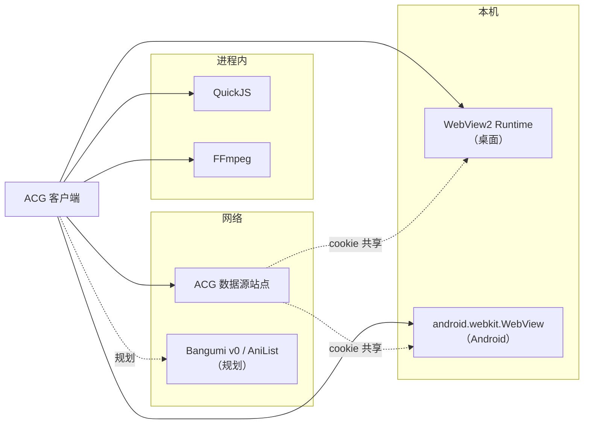
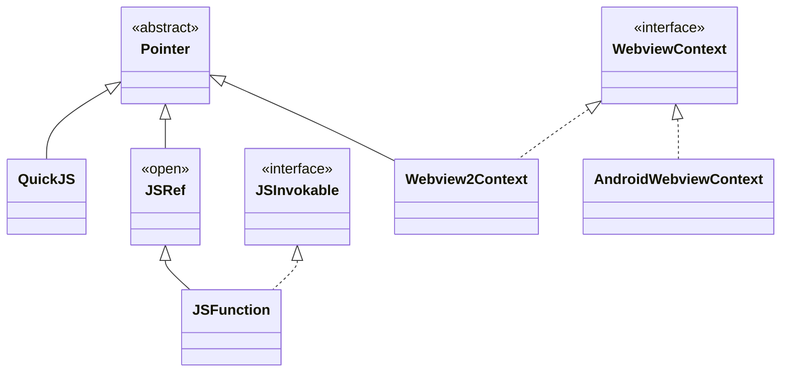
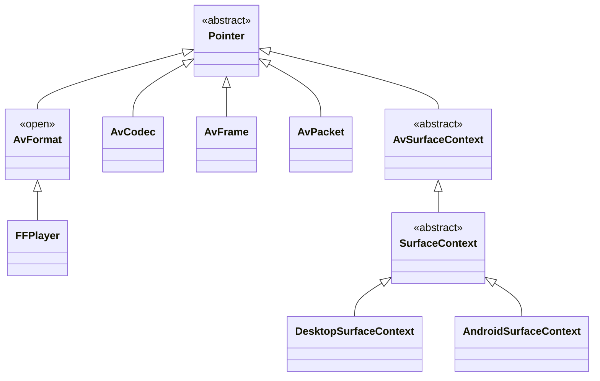
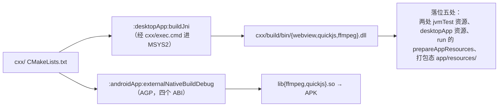
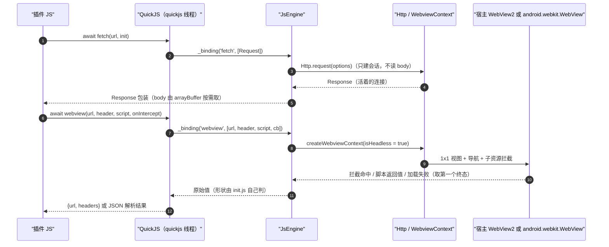
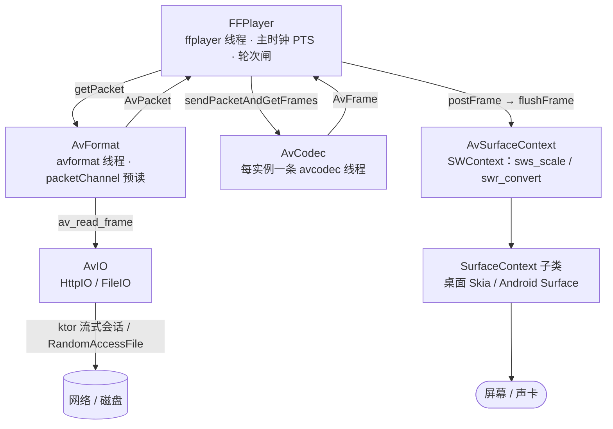

# 项目总体架构

ACG 是一个 Kotlin Multiplatform 程序，可由用户自定义脚本整合网络的ACG媒体信息。目标平台是 Android 与桌面（Windows）。它有两族
**自研的纵向能力链**：**JS 插件引擎**（QuickJS，**WebView 宿主挂在它下面** —— 桌面 WebView2 /
Android `android.webkit.WebView`）与**播放内核**（FFmpeg）。两族各自带 native 桥（`cxx/` 下三个
共享库），不套用现成的 KMP 封装 —— WebView 要的是 `WebResourceRequested` 子资源拦截、自定义
`AdditionalBrowserArguments` 与 CDP 访问，播放要的是自定义 AVIO 与逐帧送显，这些钩子在通用封装里
都拿不到（见 [cxx/AGENTS.md](../cxx/AGENTS.md)）。

与仓库里其它文档的分工是死线，先看这张表再决定读哪份：

| 想问什么 | 读哪份 |
| --- | --- |
| **当前实现长什么样、从哪读起** | 本文 |
| 改代码前必须知道的规则与陷阱 | [AGENTS.md](../AGENTS.md)、[cxx/AGENTS.md](../cxx/AGENTS.md) |
| 还没做完的事 | [TODO.md](../TODO.md) |
| 未落地的设计草案（领域模型、数据源契约、落地顺序） | [design/architecture-design.md](./design/architecture-design.md) |
| 「不报错只失效」的现象 | [development/playback-invariants.md](./development/playback-invariants.md)、[development/troubleshooting.md](./development/troubleshooting.md) |

> **当前阶段：内核骨架已跑通，业务域未落地。** 仓库里能跑起来的是两族的端到端验证面
> —— 播放页、浏览器页、脚本控制台；**没有**番剧库、收藏、条目页，也没有 `catalog`（Bangumi /
> AniList 客户端）与 `model`（领域模型）这两个包。读本文时请按「内核 + 验证面」来理解，
> 不要把 [design/architecture-design.md](./design/architecture-design.md) 的分层当成现状。

## 项目关系

ACG 只依赖**库与运行时**，目前不依赖任何自建服务端。数据源插件（`.js`）将来既可以从本地加载，
也可以联网取 —— 这条通路本身还没有实现。

| 名称 | 形态 | 说明 |
| --- | --- | --- |
| WebView2 Runtime | 桌面系统级运行时（evergreen） | 桌面端网页宿主。SDK 头与 `WebView2Loader.dll` 随仓库 vendored 在 `cxx/webview/sdk/` |
| Android System WebView | Android 系统组件 | Android 端网页宿主，直接包 `android.webkit.WebView`，不做无头化 |
| FFmpeg | git submodule（`cxx/ffmpeg/ffmpeg/`） | 只编不改。开 `--disable-network` / `--disable-protocols`，I/O 全部由 Kotlin 侧的 `AvIO` 接管 |
| QuickJS | git submodule（`cxx/quickjs/quickjs/`） | 只编不改。上游为 `ekibun/quickjs` 分支 |
| Compose Multiplatform | Gradle 依赖 | 唯一的 UI 框架，两端共用 |
| ktor + JDK / OkHttp 引擎 | Gradle 依赖 | 唯一的 HTTP 栈。桌面走 JDK 引擎，Android 走 OkHttp |
| JetBrains Skia（经 Compose） | Gradle 依赖 | 桌面端视频帧的绘画面 |
| Bangumi v0 API / AniList / JS 数据源站点 | 规划中 | 见 [design/architecture-design.md](./design/architecture-design.md) |

## 仓库结构

Gradle 四个模块，外加一个不进 Gradle 工程的原生层目录：

| 模块 | 职责 | 源码集 | 规模 |
| --- | --- | --- | --- |
| `:platform` | **平台层**：native 绑定门面、webview 契约与两端实现、播放器视图、File/Http/Time 原语 | `commonMain` / `jvmShared` / `androidMain` / `jvmMain` | ~5.0k 行 |
| `:shared` | **业务层**：UI、JS 引擎、播放接线、网络 | 生产代码只在 `commonMain`；`jvmTest` 另有 dev 工具与用例 | ~1.6k 行 |
| `:androidApp` | Android 入口（`MainActivity`，`applicationId = soko.ekibun.acg`） | — | 30 行 |
| `:desktopApp` | 桌面入口（`main.kt`，`mainClass = soko.ekibun.acg.MainKt`），并承载 `buildJni` | — | 42 行 |
| `cxx/` | **原生层**：`webview` / `quickjs` / `ffmpeg` 三个共享库 | 自研 C++ 三个翻译单元 | ~2.6k 行 |

两条容易踩的结构性事实：

- **`:shared` 只有一个生产源码集**（`commonMain`）。它是 Kotlin Multiplatform 模块（同时声明
  `jvm()` 与 `android`），但业务代码里不许出现平台符号 —— 需要平台能力就走 `:platform` 的
  `expect`。`jvmTest` 不参与打包，里面住着 dev 媒体服务器与控制条（见「开发面」一节）。
- **`:platform` 的中间层 `jvmShared`** 是 Android 与桌面 JVM 共用的**平台实现**层（`Binding` 的
  `ThreadDispatcherImpl`、`File`、`Time` 等逐字相同的那批）。只放实现、不放 `external fun`
  声明 —— 那是契约，签名全是 common 类型，留在 `commonMain` 才不改 JNI 导出符号。

## 分层

模块级只切三刀：业务（`:shared`）/ 平台（`:platform`）/ 原生（`cxx/`）；模块内部**不按包分层，按
类继承关系分**。全工程只有两族继承树，各自承载一条纵向能力链：

- **QuickJS 族**（`soko.ekibun.quickjs` + `soko.ekibun.web`）—— JS 插件引擎。**WebView 宿主挂在这一族
  下面**：后台页面是插件抓数据的手段（`webview` 能力桥 → `webviewAsync`），`WebviewContext` 因此
  不另算一条链；
- **FFmpeg 族**（`soko.ekibun.ffmpeg`）—— 播放内核。

两族共用同一副基座（`Pointer` / `ThreadDispatcher`），业务侧的 `JsEngine` 与 `VideoSurface` 调用点
只负责把它们接起来。

### 基座：`Pointer` 与 `ThreadDispatcher`

两族共用，本身不属于任何一族 —— 全部 native 资源的生命周期都从这两个类过。

- **`Pointer`** —— 持 native 句柄的对象的统一基类。本工程**不给 native 资源设 GC 兜底**
  （`Cleaner` 是 API 33，`finalize()` 已待移除），所以「忘记归还就是永久泄漏」，归还必须是显式
  动作：`close()` 先标记后投递释放，`releaseImpl` 是子类唯一要写的方法（`abstract`，不写就编译
  不过）。句柄的建立时机也被基类收口 —— 一律推迟到**首次读句柄**、且总在归属线程上。子类分两条
  形态：**覆写 `initPtr`**（句柄要现算，构造期算不了）的有 `QuickJS`、`AvFormat`（及其子类
  `FFPlayer`）、`AvCodec`、`AvPacket`、`AvSurfaceContext`（及两端实现）、`Webview2Context`；
  **句柄从构造参数进来**的是 `JSRef` / `JSFunction` / `AvFrame` —— 它们的句柄在别处已经建好了。
- **`ThreadDispatcher`** —— 归属线程即调度器。所有 native 调用都必须落在它上面（`withPtr` /
  `withPtrSync` 两扇门），`isDispatchNeeded` 覆写成「已经在归属线程就别派发」。关掉之后再投递
  **当场抛**，而不是让 kotlinx 静默改投 `Dispatchers.IO` —— 那会把「归属线程」这个承诺悄悄打破。
  进程内一共五条，按族分：`quickjs`（`QuickJS` 伴生对象）、`webview`（`Webview2Context` 伴生对象）、
  `avformat`（`AvFormat` 伴生对象）、`ffplayer`（`FFPlayer` 伴生对象的 `by lazy`）—— 这四条共享、
  **谁都不该关**；只有 `avcodec` 是每个解码器实例独占一条，随实例归还一起关掉
  （`closeDispatcherOnClose`）。

基座（`soko.ekibun` 根包 + `soko.ekibun.common`）的契约与实现 —— 只有 `loadLibrary` 与
`createHttpClientImpl` 两端各写一份，其余都收在 `jvmShared`：

| 契约（`commonMain`） | 桌面（`jvmMain`） | Android（`androidMain`） |
| --- | --- | --- |
| `expect createThreadDispatcher(name)` | `jvmShared` 的 `ThreadDispatcherImpl` —— **两端共用一份** | 同左（`jvmShared`） |
| `expect loadLibrary(name)` | 按序找 dll（策略正本在同名 `.jvm.kt`） | `System.loadLibrary` |
| `expect monoTimeMs()` / `openFileHandle(…)` | `jvmShared`：`System.nanoTime()` / `RandomAccessFile` | 同左（`jvmShared`） |
| `expect createHttpClientImpl(block)` | JDK ktor 引擎 | OkHttp |
| `interface FileHandle` | `jvmShared` 的 `RandomAccessFileHandle` | 同左（`jvmShared`） |

### QuickJS 族（`soko.ekibun.quickjs` + `soko.ekibun.web`）

`Pointer` 下并排两条分支：

- **引擎分支 `QuickJS` → `JSRef` → `JSFunction`**。`QuickJS` 覆写 `initPtr`（要拿 `this` 去
  `initContext` 换，而 `this` 在 `super(...)` 的实参里还不可引用）；`JSRef` 是 JS 值的引用计数句柄，
  带 `dup` / `free`，句柄由调用方解出来后从构造参数进来；`JSFunction` 是 `JSRef` 唯一的子类 ——
  函数是唯一还以包装形式存在的 JS 对象，`invoke` 因而挂在这一层而不是 `JSRef` 上。
- **宿主分支 `WebviewContext`（接口，`AutoCloseable`）→ 两端实现**。桌面 `Webview2Context` 直接继承
  `Pointer`（`initPtr` 那条路同样覆写了），归属线程 `webview`，接口上的命令因此全是挂起的、落到宿主
  线程执行完再返回；Android `AndroidWebviewContext` **不是** `Pointer` —— 那边是
  `android.webkit.WebView` 真身、没有 native 句柄，命令走 `withContext(Dispatchers.Main)`。

| 契约（`commonMain`） | 桌面（`jvmMain`） | Android（`androidMain`） |
| --- | --- | --- |
| `expect createWebviewContext(isHeadless)` | `Webview2Context`：自研 C++ 宿主 + 隐藏窗口 | `AndroidWebviewContext`：`android.webkit.WebView` 真身 |
| `internal expect WebViewSurface(controller, …)` | `SwingPanel { Canvas }` + JAWT `SetParent` 挂 Win32 子窗口 | `AndroidView` |
| `expect getWebviewCookieManager()` | `WebView2CookieManager`（宿主 cookie 库） | `AndroidWebViewCookieManager`（系统 `CookieManager`） |

树外还有同族的这几样：`WebviewCookieManager` 接口（两端各一个 `object`）、sealed 数据面
`WebViewEvent` / `WebViewLoadingState`（在 `commonMain` 里折进 `WebViewState`）、以及可见页那套
`WebViewConfig` / `rememberWebViewState`。业务侧的收口是 `JsEngine`：它持唯一的 `QuickJS`，把
`_binding` 的 `webview` 方法落到同文件里的 `webviewAsync`（见下文「脚本插件链」）。

### FFmpeg 族（`soko.ekibun.ffmpeg`）

`Pointer` 下五个子类，从解封装排到送显；另有一条**刻意不继承**的：

- **`AvFormat`（`open`）→ `FFPlayer`** —— 播放器是格式层的**子类而不是持有者**：解复用、seek、取包
  这些能力直接在父类上，`FFPlayer` 只加播放 / 暂停 / 送显与事件上报。
- **`AvCodec`** —— 解码器，自带独占的 `avcodec` 归属线程，句柄覆写 `initPtr` 拿（要绑到
  `stream.ptr` 上）。
- **`AvFrame` / `AvPacket`** —— 帧与包的句柄：`AvFrame` 的指针由 native 解出来后从构造参数进来，
  `AvPacket` 则覆写 `initPtr`（要调实例方法 `initNative()`）。
- **`AvSurfaceContext`（`abstract`，native 输出端 `SWContext` 的门面）→ `SurfaceContext`（`abstract`，
  两端共用、需要被 Compose 观察的那点状态，如 `aspectRatio`）→ 两端实现**。`initPtr` 在这一层覆写：
  建句柄要读子类实现的 `sampleRate` / `channels` / `audioFormat`，构造期它们还都是 `0` —— 正是基类
  「推迟到首次读」那条规则的用途。
- **`AvStream` 刻意不继承 `Pointer`** —— 它借的是 `AvFormat` 的指针，继承会被 `use {}` 在末尾把
  别人的资源关掉（依据写在 `Pointer` 的类文档里）。

| 契约（`commonMain`） | 桌面（`jvmMain`） | Android（`androidMain`） |
| --- | --- | --- |
| `expect VideoSurface(onSurfaceContext, …)` | 建 `DesktopSurfaceContext`：Skia `makeRaster` 绘制 + `javax.sound.sampled` | 建 `AndroidSurfaceContext`：`Surface` 贴图 |

树外接口是 `AvIO`（+ `AvIO.Handler`），实现落在 `:shared` 的 `HttpIO` / `FileIO` —— native 的 avio
回调从这里进来（见下文「播放链」）。它反过来：实现不持 native 句柄，只被 native 同步调用。

### 业务层（`:shared`）—— 两族的调用方

`shared/src/commonMain/kotlin/soko/ekibun/acg/` 下四个包，都不进任何继承树，只把上面两族接起来：

- **`ui`** —— Compose 界面。`App.kt` 是两端共用入口，一个 `PrimaryTabRow` 挂三个页签：
  `PlayScreen`（播放）、`WebScreen`（浏览器）、`CodeScreen`（脚本控制台）。`ui/comp` 放与业务
  无关的小组件（如 `highlight` 代码着色）。
  三个页**都是内核验证面**，不是产品界面 —— 业务四页（收藏 / 详情 / 搜索 / 设置）未落地。
- **`engine`** —— `JsEngine`，全进程单例（`JsEngine.instance`）。持一个惰性建的 QuickJS runtime，
  把 JS 侧那一**份**能力桥 `_binding(method, args)` 落到 Kotlin 原语上；后台 WebView 驱动
  `webviewAsync` 也住在这个文件里。细节见下文「脚本插件链」。
- **`player`** —— `AvIO` 的两个 Kotlin 实现：`HttpIO`（range 会话 + 白读推进 + 闲置超时）与
  `FileIO`（本地文件）。它们被 native 的 avio 回调**同步调用**，是播放链唯一与网络/磁盘相接的地方。
- **`common`** —— `Http`：ktor 的流式会话收口。**不缓冲** body，返回一条活着的 `Response`，
  两条读法（播放器用的 `read`、JS 用的 `readAll`）共用一个 `close`。闲置超时
  `SOCKET_TIMEOUT_MS = 8000` 只在这里实现一次，两端行为才一致。

### 原生层（`cxx/`）

三个共享库，各自一个翻译单元 + 一份 `README.md`（架构与时序的正本）：

| 目标 | Kotlin 面对应 | 原生侧内容 |
| --- | --- | --- |
| `webview` | `soko.ekibun.web.Webview2Context` | 环境单例（进程内共享同一 user data folder ⇒ cookie 天然共享）、每上下文一个窗口、STA 消息泵线程、全部 JNI 入口 |
| `quickjs` | `soko.ekibun.quickjs.*` | `JSRuntime` + `JSContext` 句柄、Java ↔ JS 双向互操作、Promise ↔ `Deferred`、模块加载回调 |
| `ffmpeg` | `soko.ekibun.ffmpeg.*` | 自定义 `AVIOContext`（回调进 `AvIO`）、解封装、解码、`SWContext` 软转码（视频钉死 `AV_PIX_FMT_RGBA`）、Android `Surface` 上传 |

线程模型都是同一句话：**native 侧没有任何线程**。`quickjs.cpp` / `ffmpeg.cpp` 全是同步 JNI 调用，
在哪个 Kotlin 线程上被调就在哪条线程上跑；`webview.cpp` 例外地有一条 STA 线程，但它只跑 COM 的
事件循环，JNI 侧通过「任务队列 + 消息泵」投递，不存在两条线程同时碰同一份状态。

构建有**两条独立的路**，改了 `cxx/` 两边都要验：

落位是自动的（所有消费链的任务图都挂着 `buildJni`），**但 Hot Reload 换不了 native 库** ——
`System.load` 在进程启动时就做完了，改完 `cxx/` 必须整进程重启，否则你以为在测新代码、其实跑的是
旧 dll。加载顺序与 dll 查找策略的正本在
[`platform/src/jvmMain/kotlin/soko/ekibun/Binding.jvm.kt`](../platform/src/jvmMain/kotlin/soko/ekibun/Binding.jvm.kt)。

## 两条纵向能力链

### 脚本插件链（`JsEngine` + WebView）

数据源插件的执行环境。`init.js` 从 Compose 资源里读出来（`files/js/init.js`，按需模块在
`files/js/module/`），在 QuickJS 里求值一次，往 JS 全局注入 `fetch` / `Response` / `Request` /
`FormData` / `TextEncoder` / `TextDecoder` / `Cookies` / `console` / `webview` / `encodeURI…`；
**执行期间注入的那一份 `_binding` 就是全部能力**，Kotlin 侧用一个 `when` 直接派发到各能力
（不按名字反射查找 —— 判据见 [design/quickjs-ability-bridge.md](./design/quickjs-ability-bridge.md)）。

`import()` / `require()` 被**禁用**：QuickJS 的动态导入会撞上本桥的模块加载路径，直接把进程
`abort()`（实测两条路径都崩），所以 `webview` 这类能力是**内联**在 `init.js` 里的，没有对应的
`module/webview.js`。

后台 WebView 与用户看的那一页是**同一个 `WebviewContext` 类型**，差别只在 `isHeadless` 与调用方
怎么用；两端的可见页与后台页共用同一份 cookie 存储（桌面共用一个 user data folder，Android 共用
系统 `CookieManager`）。契约层的裁定见
[design/webview-context-redesign.md](./design/webview-context-redesign.md)。

### 播放链（`FFPlayer`）

自研 FFmpeg 内核，从 demux 到上屏全在 Kotlin 侧编排：

几条不显然但必须成立的约束（判据与实测在
[development/playback-invariants.md](./development/playback-invariants.md)）：

- **同一时刻只允许一轮播放在飞**。native 侧每种流只有一块输出缓冲，所以「本轮还作不作数」只看
  `PTS` **对象身份**（`takeOverPlayback`），后到者顶掉先到者。
- **seek 必然落关键帧**（容器物理限制）。「平滑」要两步：先把主时钟拨到目标，再丢掉关键帧到目标
  之间的帧（`resyncTo` 收敛，对应 ffplay 的 `frame_drops_early`）。两者缺一不可。
- **送显与丢帧的先后**：同一轮内相邻两帧必须**先等上一帧送显完**，否则上一帧会显示成本帧的像素。
- **暂停不停取包**：轮次判据不含 `pts.playing`，暂停期间照常解码入队 —— 这就是预读缓存。
- **`HttpIO.read` 里存在唯一的 `runBlocking`**（native 回调要同步签名）；数据没到时在 IO 层阻塞
  等，「作废」由 `Handler.abort()` 叫醒，会话不掀。

## 跨层的三条约定

1. **一切 native 访问都在归属线程上**，由 `Pointer.withPtr` / `withPtrSync` 收口；`ptr` 的裸读带
   同线程断言（JVM `-ea`），跨线程读在测试期就炸，而不是偶发崩在 native 里。
2. **平台层只发事件，状态折算只有一份**。平台回调（native 线程 / Android 主线程）往
   `WebViewEvent` 里塞事件，折算到 `WebViewState` 的代码只有 `commonMain` 那一处 —— 假进度插值、
   失败兜底也都在公共代码里。
3. **归还必须是显式动作**。`close()` 幂等、先标记后释放；`closeDeferred()` 给需要等释放落地的
   场合用。没有 GC 兜底，也没有「顺手关掉别人的资源」—— 借用型的对象（如 `AvStream`）不继承
   `Pointer`。

## Lineage

架构不是凭空来的，每一层都能指到一个已跑通的参照实现（源码都在 `.workbuddy/ref/`，只读）：

| 本工程的 | 参照 | 继承了什么 |
| --- | --- | --- |
| `cxx/quickjs` + `_binding` 桥 | [`flutter_qjs`](https://github.com/ekibun/flutter_qjs) / `neko`(2020) | `JS_TAG_*` 分派口径、`jsToJava` / `javaToJs` 互操作思路、「关闭前清算泄漏」 |
| `cxx/ffmpeg` + `FFPlayer` | [`flutter_ffplay`](https://github.com/ekibun/flutter_ffplay) | 自定义 AVIO、`sendPacketAndGetFrames` 解码节奏、主时钟对齐的播放模型 |
| `init.js` 的能力面 | `BangumiPlugin` 的 `modules/http.js` | 各能力的签名与用法（`webview` 的位置参数完全一致） |
| 领域模型与分层草案 | `bangumi-onair` / `animeko` / `neko` | `Subject` / `Episode` / `Line` 的形状、插件契约的演化路径 |

## 开发面（不参与打包）

`:shared:jvmTest` 里除了用例，还住着一套**跑应用时用的开发工具**（`:platform:jvmTest` 只有用例）：
dev 媒体服务器（`DevServer` / `TestMediaServer`）、应用内的 DEV 控制条（`DevStrip`，经
`-Dacg.dev.classpath` 用子 ClassLoader 装载）、以及把它们挂到 `hotRun` 应用进程上的
`DevToolsAgent`（premain agent）。服务器与 `hotRun` 同生共死，生命周期归 agent ——
Gradle 只传 `-javaagent` 与 `-D`。

两处 jvmTest 的资源都从 `cxx/build/bin` 取 native 库（`jvmTestProcessResources` 显式
`dependsOn(":desktopApp:buildJni")`），保证「改了 `cxx/` 只跑测试」也不会静默用旧 dll。

`PlayScreen` 默认指向 `http://127.0.0.1:8099/media`。控制条能冻结 / 恢复 / 限速，用法见
[development/debug-playback.md](./development/debug-playback.md)。
