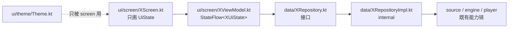

# 领域架构设计（草案，未落地）

> 这是**目标形态的设计**，不是当前实现。当前实现的地图见 [../architecture.md](../architecture.md)。
>
> 依据 2026-10-02 调研（Bangumi v0 / AniList / animeko / nezumi），完整记录见
> [./architecture-research.md](./architecture-research.md)。未落地，仅设计。
>
> 另已实地阅读 [neko](https://github.com/ekibun/neko)（2020，Flutter/Dart，本 lineage 最早落地实现，
> 源码在 `.workbuddy/ref/neko`），其 `engine` 层是 ACG `engine` 包的直接起源，见 §0。

## 0. 来源 lineage（neko）

neko（2020，Flutter/Dart）是「QuickJS + JS 数据源 + WebView 桥」架构的最早落地，早于
animeko / nezumi。结论均来自实地阅读 `.workbuddy/ref/neko`，关键文件：

- `lib/engine/datasource.dart`：`DataSource` 持有**单个** `IsolateQjs`（QuickJS 跑在 isolate），
  用 `_methodHandler` 把 JS 调用分发到 Dart 原语；`_moduleHandler` 按 `@init` / `@provider/<site>`
  / `module/<name>` 解析 `js/*.js`。
- `js/init.js` 注入 JS 全局：`fetch`（底层 Dio，返回带 `arrayBuffer/text/json` 的 `Response`）、
  `HtmlParser`（`html/dom`，暴露 `query/queryAll/attr/text/html/outerHtml/remove`）、
  `Xpath`（`xpath_parse`）、`webview`（flutter_webview，100s 全局 / 10s 导航完成超时，cookie 共享）、
  `TextEncoder/TextDecoder`（flutter_iconv）、`FormData`、`console`、`encodeURI/Component`。
- 数据源即 ES module：`js/provider/<site>.js` 经 `import("@provider/<site>")` 加载，
  导出 `search(key, page)` / `getSubjectInfo(subject)` / `getEpisode(ep)`（见 `bgm.tv.js`）。
- 持久化 `lib/db/`：moor/sqlite，单库 `neko.sqlite` 跑在 background isolate；
  `Subjects(site,id,type,name,image,summary)` + `Collections(site,id,relate,lastViewEp,score,comment,tags,createTime,updateTime)`，
  `(site,id)` 复合主键 + 外键。运行时 `Subject` 是松散 `Map`（`subjectfromMap`），非强类型。
- 状态：`lib/page/*` 用 Flutter `Provider`；条目页重触发时用 `Completer.completeError("cancel")`
  取消旧任务——可复用的取消范式。

ACG 继承 / 偏离：

| 继承（来自 neko） | 偏离（ACG 草案） |
| --- | --- |
| `(site,id)` 复合主键 → `SubjectRef` | 运行时强类型 `Subject`/`Episode` 模型，不再用松散 `Map` |
| QuickJS + Dart 原语桥（`fetch`/`HtmlParser`/`webview`/编码）→ `engine` 包 | 持久化改 kotlinx-serialization JSON 分片，而非 sqlite |
| provider module 加载 + `search` 入口契约 | JS 契约演化为 `getEpisodeList`/`resolveEpisode`（§2），拆出线路与解析 |

## 1. 分层

```
UI (Compose: 收藏/搜索/条目/播放/设置)
 │
 ├─ model      领域模型（§2）            ← 只此一份，UI 唯一消费形状
 ├─ catalog    Bangumi v0 客户端 + 手写 mapper（P2: anilist）
 ├─ engine     QuickJS + JS 数据源契约（search / getEpisodeList / resolveEpisode）  // 桥机制见 §0 neko
 ├─ web        可见/后台 WebView（同实例两种可见态，§4）
 └─ player     自研 FFmpeg 内核 + HttpIO/FileIO（m3u8 内核自解，headers 进 AvIO）

持久化：kotlinx-serialization JSON 文件分片（collection / lines / history）
同步：  本地先行 + 失败重试（直连 Bangumi，last-write-wins 用本地时间戳）
```

### 1.1 UI 层内部结构

上面那张图只切到「UI 是一层」，没定这一层内部怎么组织。对齐 nowinandroid 的 UDF
（[ModularizationLearningJourney](https://github.com/android/nowinandroid/blob/main/docs/ModularizationLearningJourney.md)）
后补齐为：**一个页面一个纵向切片，层内依赖单向**。



四条硬约束：

- **`ui/screen` 不许 import `source` / `engine` / `player` 的具体实现类。** 要数据只经
  `data` 的 Repository 接口；数据源客户端（`BgmSource` 一类）是实现的内部细节。
- **状态只有一个出口**：`StateFlow<XUiState>`，`XUiState` 是不可变 `data class`，把分散的可变
  字段收成一份；UI 不持有 `var`，非法组合（如 `loading` 与 `error` 同时成立）用 `sealed` 或
  字段约束排掉。
- **事件单向**：UI 只调 `viewModel.onAction(...)`；挂起函数留在 ViewModel 里，不暴露给界面。
- **主题只有一处**：`ui/theme/Theme.kt` 的 `AcgTheme`，明暗两套 `ColorScheme` + 一份
  `Typography`；界面不出现裸 `Color(...)` 字面量（语法高亮调色板除外）。

不引入 nowinandroid 的 `core:designsystem` 规模（catalog App、图标集、组件库），也不引入
domain/use case 层 —— 当前没有跨 feature 复用的用例，加一层只会多出一堆单行转发。

`androidx.lifecycle.ViewModel` 走已有依赖 `org.jetbrains.androidx.lifecycle:lifecycle-viewmodel-compose:2.11.0`
（`shared/build.gradle.kts`），`commonMain` 可用，**不新增依赖**。

**nowinandroid 没有官方 KMP 版**（`android/nowinandroid` 是 Android-only，无 iOS/desktop/`commonMain`
目标）。社区版 [nowinkmp](https://github.com/lihenggui/nowinkmp) 只迁完 `core:*` 与
`app-nia-catalog`，`feature:*` 与 `app` 均未开始 —— 能参考 core 层，参考不到 feature 层。共享 UI
形态的完整样本是 Kotlin [官方样本列表](https://kotlinlang.org/docs/multiplatform/multiplatform-samples.html)
里的 Rijksmuseum 与 Shopping By KMP（多模块 + CMP + ViewModel + Koin）。因此本文只搬 NiA 的
**约定**，不搬它的模块图，仅两处必须替换：

| nowinandroid | 本工程 |
| --- | --- |
| Hilt（KSP 只覆盖 Android/JVM） | 构造注入；容器方案等第二个数据源出现再定 |
| `dynamicLightColorScheme` / `dynamicDarkColorScheme`（Android 12+） | `AcgTheme` 自带明暗两套 `ColorScheme`，桌面端无等价物 |

## 2. 领域模型

```kotlin
data class SubjectRef(val site: String, val id: String)   // site: "bgm"/"anilist"/JS 源站名

data class Subject(
  val ref: SubjectRef, val type: SubjectType,             // BOOK/ANIME/MUSIC/GAME/REAL（1/2/3/4/6）
  val name: String, val nameCn: String?,                  // AniList → nameCn=null
  val cover: String?, val coverColor: String?,            // 单 URL + 主色占位
  val summary: String?, val date: PackedDate,             // Int 位打包年月日，Invalid 哨兵
  val platform: String?,                                  // "TV"/"OVA"/"剧场版"
  val episodeCount: Int, val volumeCount: Int,
  val rating: Rating?, val nsfw: Boolean,
  val tags: List<Tag>, val aliases: List<String>,
  val infobox: List<InfoboxEntry>?, val airWeekday: Int?, // 1-7，放送表用
  val related: List<RelatedSubject>,                      // 13 值归一枚举 + raw 原串
)

sealed class EpisodeSort : Comparable<EpisodeSort> {       // "01"/"24.5"/"SP01"/"OVA"
  class Normal(val number: Float); class Special(val type: EpisodeType, val number: Float?); class Unknown(val raw: String)
}

data class Episode(                                        // 照 Bangumi v0 形状（唯一有剧集表的源）
  val id: String, val type: EpisodeType,                   // 0-6 本篇/SP/OP/ED/PV/MAD/其他
  val sort: EpisodeSort, val ep: EpisodeSort?,
  val name: String, val nameCn: String?,
  val airdate: PackedDate, val durationSeconds: Int, val disc: Int?,
)

data class Line(val site: String, val id: String, val title: String = "", val extra: String? = null)
// Line 绑定到 SubjectRef（哪些站点条目对应本条目 + 默认线路），对齐靠 EpisodeSort + extra 偏移

data class CollectionEntry(
  val subject: SubjectRef,
  val status: CollectionStatus,                            // WISH/DOING/DONE/ON_HOLD/DROPPED/NOT_COLLECTED
  val score: Int,                                          // 0-10，0=未评（AniList /10 归一）
  val progress: Int, val progressVolumes: Int,
  val comment: String?, val private: Boolean, val tags: List<String>,
  val updatedAt: Long,                                     // epochTimeMs()（新增 expect 墙钟原语）
)

data class HistoryEntry(                                   // 继续观看，仅本地
  val subject: SubjectRef, val line: Line, val episodeSort: EpisodeSort,
  val positionUs: Long, val durationUs: Long, val updatedAt: Long,
)

data class PlaybackInfo(val url: String, val headers: Map<String, String> = emptyMap())  // 运行时，不落盘
```

JS 数据源契约（不动现有四参签名）：

```js
search(key, page)                 → [{ name, image, summary, id, lines? }]
getEpisodeList(line)              → [{ sort, name, ... }]        // 可选：站点自己的剧集表
resolveEpisode(line, episode)     → { url, headers? }            // sort + line.extra 算 URL；m3u8 直链亦可
```

> neko 的 `search` / `getSubjectInfo` / `getEpisode` 是此契约的早期形态（provider 内 HTML 抓取、
> 不区分线路）。这里把「按线路取剧集表 + 解析播放 URL」从 provider 里拆出来，对应 neko 的
> `getSubjectInfo`（补元数据）与 `getEpisode`（取单集）。provider module 加载与 Dart 原语桥
> （`fetch`/`HtmlParser`/`webview`）沿用 §0 已验证的机制。

## 3. 关键决策

| 决策 | 理由 |
| --- | --- |
| 主键 `SubjectRef(site, id: String)` | Bangumi/AniList Int 撞号；JS 源 id 是 `"20090010/1"` 类串 |
| `Episode` 照 Bangumi 形状 | 唯一有剧集表的源；AniList 无 per-episode 数据 |
| 线路域与元数据域分离，sort 数值对齐 | onair/nezumi/BangumiPlugin 三代已验证；URL 不持久化 |
| 进度上报/同步按 episodeId；sort 只做排序、邻集与线路对齐 | animeko 全链路验证 |
| 收藏 5 态 = Bangumi 口径 + `NOT_COLLECTED` 哨兵 | 它是可同步主源；AniList REPEATING→DONE+本地 repeat |
| 同步 last-write-wins 用**本地**时间戳 | Bangumi `updated_at` 有官方 bug 不可靠 |
| 模型放 `acg.model`，客户端放 `acg.catalog.bgm`；不进 `acg.engine` | engine 类名是对外契约，改了静默失效 |
| 手写 DTO + 扩展函数 mapper，不引 OpenAPI generator | 只用 6-8 个接口；Animeko 的 mapper 也是这么写的 |
| `HtmlParser` 进 `_binding` 桥（engine 包） | 补齐 JS 侧 DOM 解析缺口，同时是订阅解释器的依赖 |
| 主键 `(site,id)` 复合键 | neko 已用 `Subjects(site,id)` + 外键验证；ACG 收敛为 `SubjectRef` |
| QuickJS + Dart 原语桥（`fetch`/`HtmlParser`/`webview`/编码） | neko `DataSource` + `js/init.js` 已跑通；ACG `engine` 包直接继承 |
| 持久化用 JSON 分片而非 sqlite | neko 用 moor/sqlite；ACG 选文件分片以匹配 Kotlin 多平台与纯本地先行 |

## 4. WebView 前后台会话

**按任务一实例；前台 = 同一实例的可见态。** 悬浮球（App 级 overlay，非 WebScreen 私有）点击后把任务实例的 `WebViewSurface` 叠在浏览页之上；两层都保持在组合里，靠叠放次序切换。任务被显示期间 30s 超时暂停。不做全局单实例（并发互砸、clearCache 防串失效、砸用户浏览页）。

落地缺口：Android 显示时重配 `blockNetworkImage`、会话中不 `clearCache`；引擎侧任务注册表。
桌面原生那两条已随重写后的 `cxx/webview/webview.cpp` 一并落地：`attach` 里已有
`put_IsVisible` 与 `AttachThreadInput`（跨线程输入队列接续，接上不摘），也没有
`View.background` 那个标志。
原先记的「后台控制器是 `by` 委托对象、强转会 ClassCastException」**已随 2026-10-13 的接口重设计消失**
（见 `./webview-context-redesign.md`）：可见页与后台任务现在是同一个 `WebviewContext`
实现类，没有委托对象，也没有强转。
纯登录墙可不投前台（cookie 已共享）。

## 5. 落地顺序

> **2026-11 重排：骨架前置。** 现有业务界面按一次性验证面处理，回到空目录重写，并按 §1.1 的
> UDF 组织。顺序因此加一步「骨架」，且它必须排在业务页之前 —— 页面归零之后，主题与页面结构
> 不再是装修而是地基，晚定一天就要多返工一个页面。
>
> 「推到」的边界，不是整个 `ui/`：
>
> | 处理 | 内容 | 理由 |
> | --- | --- | --- |
> | **保留并搬进新结构** | `ui/screen/CollectionState.kt` 的 `generation` 过期应答、凭据回填、分页 | 是真业务逻辑，[shared-layer §5.3](../development/shared-layer.md) 有判据，丢了要重查一遍 |
> | **保留** | `ui/comp/RemoteImage.kt` | 图片缓存的 7 条约束（预算按解码字节、`redirect = "follow"`、取消原样抛）写在 [shared-layer §5.1-5.2](../development/shared-layer.md) |
> | **已挪进测试** | `DebugPlayScreen` / `DebugWebScreen` / `DebugCodeScreen` | 内核验证面，放在 `:shared:jvmTest` 的 `ui/screen`（与正式页面同包，靠 `Debug` 前缀区分），每页一个 `main`（`:shared:debugPlay` / `debugWeb` / `debugCode` 起真窗口），不进 `jvmTest` 任务 |
> | **归零重写** | `CollectionScreen`、`App.kt` 的 tab 骨架、`ui/comp` 其余展示件 | 只承载布局；`PlayerSlider` 的缓冲态渲染逻辑先抄走再重写 |
>
> 业务页的推进方式改为「一次一个切片」：骨架 → 收藏（真 UDF）→ 详情 → 搜索 → 设置。

> **落地状态（2026-10 更新）：** 第 2 条已经落了**第一个切片**，但形态与本文草案不同，以
> [./bgm-plugin.md](./bgm-plugin.md) 为准：
> - 包名是 `acg.source`（`BgmSource`），**不是** `acg.catalog.bgm`；「不进 `acg.engine`」这条
>   仍然成立，§3 里那一行按新包名读。
> - DTO + mapper 只做了**收藏**这一条链路（`me` / `collections`），`Subject` / `Episode` 那套
>   领域模型一个都没建 —— 收藏页要的字段直接从应答折到界面用的 data class。

> **落地状态（2026-11 更新）：** 上述实现已整体删除 —— `ui/screen/collection/`（旧收藏页与
> `CollectionState`）、`acg/source/BgmSource.kt` 及其测试都不在了，改为「跟着 UI 一步步做」：
> 页面做到哪一步就建那一处需要的数据层，不预先铺 DTO / mapper。当前只有
> `acg/data/AccountRepository.kt`。上表「保留并搬进新结构」那行里的 `generation` 过期应答、
> 凭据回填与分页，重写收藏页时按 [shared-layer §5.3](../development/shared-layer.md) 与
> [bgm-plugin.md](./bgm-plugin.md) 重建。
> - 服务商知识**不在 Kotlin 里**，挪进了 JS 插件 `files/js/module/bgm.js`；§3 里「客户端放
>   `acg.catalog.bgm`」的隐含前提（Kotlin 侧直接调 v0）没有采纳。
> - 限流退避、`epochTimeMs()`、kotlinx-serialization、`model` 包、持久化分片**都还没做**；
>   目前唯一的持久化是扁平的字符串设置表（凭据 + token）。

0. **骨架**（先做，不动能力链）：`ui/theme/Theme.kt` 的 `AcgTheme`、`App.kt` 的顶层 tab、
   `data/` 下第一个 Repository 接口位。判据：新页面只靠 `ui/screen` + `data` 两处就能写完，
   不需要碰 `source` / `engine` / `player`。
1. `epochTimeMs()` 原语 + kotlinx-serialization 依赖（改依赖先确认）+ `model` 包类型
2. `acg.catalog.bgm`：DTO + mapper + 限流退避（UA 必带，~3 req/s）
3. 持久化分片 + 收藏/历史仓库（本地先行）
4. `HtmlParser` 宿主原语 + JS 数据源契约（search/resolveEpisode）+ Line 绑定
5. 业务四页 UI：收藏（第一个真 UDF 切片）→ 详情 → 搜索 → 设置，从 §1.1 的结构写起
6. WebView 投前台（先 Android 验证交互，再桌面 C++ 小改）
7. P2：AniList mapper、per-episode 精确进度、Animeko 订阅兼容解释器（`"a"`+`"no-channel"` 先行）、边播边缓存、torrent
