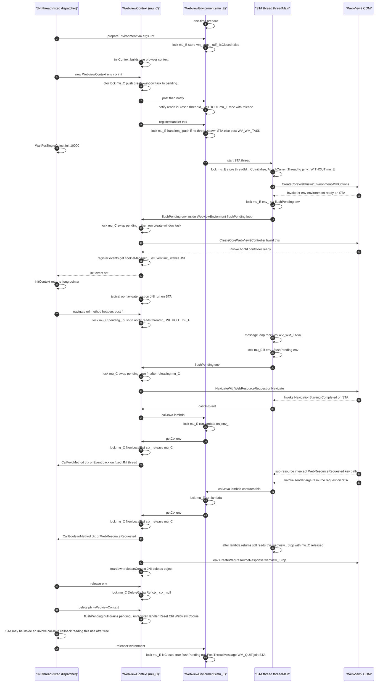

# webview.cpp 时序图与锁检查

> 不动代码，纯静态走读。两个线程：
> - **JNI 线程**：Kotlin dispatcher，固定一条线程，所有 `Java_soko_ekibun_web_Webview2Context_*` 入口都跑在这条线程上。
> - **STA 线程**：`WebviewEnviorment::threadMain`，宿主唯一一条 WebView2 / COM 单线程套间线程。
>
> 两把锁不是同一把：`WebviewEnviorment::mu_`（下称 **mu_E**）与 `WebviewContext::mu_`（下称 **mu_C**）。

## 时序图（Mermaid）

## 锁检查结论

### 1. 锁序：E→C 单向，无死锁（设计/巧合地正确）

所有跨锁获取都是 **mu_E 在前、mu_C 在后**：

- `WebviewEnviorment::flushPending`（持 mu_E）→ 调 `WebviewContext::flushPending`（取 mu_C）。
- `callJava`（持 mu_E）→ lambda 内 `getCtx`（取 mu_C）。

反向边（mu_C → mu_E）**不存在**：`post_()` 持 mu_C 时调用的 `notify()` **刻意不取 mu_E**，只做无锁读。正因为没有 C→E 边，锁图是无环的，不会出现 A 持 E 等 C、B 持 C 等 E 的死锁。参数校验：没有一条路径在持 mu_C 期间去取 mu_E。

### 2. ⚠ 缺陷 A：`notify()` 读共享字段未持 mu_E（数据竞争 + 可能丢唤醒）

`notify()`（行 320-325）读 `isClosed` 与 `threadId_`，但**不加 mu_E**；而这两个字段的写者（`releaseEnvironment` 行 278、`threadMain` 行 407）都持 mu_E。

- `post_()` 在持 mu_C 时调用 `notify()`，与持 mu_E 的写者构成 **data race**。
- `threadId_` 由 STA 线程在 `threadMain` 里设置；若首批 `post_` 的 `notify()` 在 `threadId_` 被写入前读到陈旧 0，那条 `WV_WM_TASK` 唤醒就丢了。
- 实践中被 `registerHandler`（持 mu_E 的 `PostThreadMessageW`，行 296/299）掩盖，所以通常看不出问题，但同步纪律是错的。

### 3. ⚠ 缺陷 B：`jenv_` 写者不持 mu_E，读者持 mu_E

- 写：`threadMain` 行 415 `AttachCurrentThread` 与行 444-445 `DetachCurrentThread` + `jenv_=nullptr`，**均在 mu_E 临界区之外**。
- 读：`callJava` 行 311 在 `lock_guard(mu_E)` 内读 `jenv_`。

读写不同步。x86 上指针读写本身原子，主要风险在退出路径（行 445 把 `jenv_` 置空）与某个迟到的 `callJava` 并发；属一致性缺陷，不是热路径崩点。

### 4. ⚠ 缺陷 C（核心隐患）：对象生命周期没有任何锁守护 —— use-after-free

`releaseContext`（JNI 线程）做 `release(env)` 后直接 `delete ptr`（行 997-998）。而 STA 线程上所有 `Invoke` 回调（WebResourceRequested / Navigation* / Script / GetCookies）以及它们里的 `callJava` lambda **都捕获 `this`（WebviewContext*）并读 `this->ctx_`、`this->webview_` 等成员**：

- `getCtx` 的 `ctx_==null` 守卫只在 **mu_C 临界区内**生效；守卫过后 lambda 继续用 `this`（例如 WebResourceRequested 在 `callJava` 返回后还 `if (webview_) webview_->Stop()`，行 742），此时 **mu_C 已释放**。
- 析构 `~WebviewContext` 里的 `flushPending(nullptr)`（行 543）只排干 `pending_` 队列里的**待执行任务**；它**不等待 STA 线程正在飞的 `Invoke`/`callJava` 回调结束**。
- mu_E 与 mu_C 守的都是**成员数据**，不是 `this` 的寿命。teardown 的"先静默、再调 releaseContext"只是 Kotlin 侧的调用约定，**没有任何锁或内存屏障强制**。

后果：若 `releaseContext` 与某个正在 STA 线程执行的 `Invoke` 并发，`delete` 之后 STA 线程会读已释放的 `this` → use-after-free（典型"不报错、只失效/偶发崩"）。

> 补充：`releaseEnvironment` 会 `join(STA)`（行 283），所以只要 Kotlin 侧**保证先 releaseContext 所有上下文、再 releaseEnvironment**，STA 线程退出后就不会再有在飞回调，缺陷 C 在实际上被调用顺序掩盖。但代码层面没有用锁保证这个顺序。

### 5. 其他值得记一笔的点

- `WebviewContext::flushPending`（行 567-574）先 `swap(pending_)` 再释放 mu_C、最后跑 functor——**不在持锁期间执行 COM 任务**，正确；也因此不会在 env 侧 flushPending 持 mu_E 时长时间占 mu_C。
- 没有"在持 mu_E 期间通过 post_ 回调再调 callJava"的路径（post_ 的任务都不直接 callJava，ScriptHandler/GetCookiesHandler 的 `Invoke` 是后续独立回调，不在 env flush 持 mu_E 的窗口内），所以**没有 mu_E 重入死锁**（`std::mutex` 非递归）。
- `init` 事件在所有失败分支都会被 `SetEvent`（`env==null` 任务行 532、`ctrl Invoke` 失败行 625、成功行 657），`WaitForSingleObject(init,10000)` 不会永久挂。

## 修复建议（仅分析，未改代码）

1. **缺陷 C（最关键）**：teardown 必须等 STA 线程排空在飞回调再 `delete`。可加一个原子"在飞回调计数"或专属退出事件：最后一个 `Invoke`/`callJava` 离场后再允许 `delete`；或让 `releaseContext` 把"销毁"也作为一条任务投到 STA 线程执行（在 STA 线程内做 `unregisterHandler`+`Reset`+`delete`），从根本上消除跨线程寿命竞争。
2. **缺陷 A/B**：`notify()` 的 `isClosed`/`threadId_`、`jenv_` 改用 `std::atomic`，或把写者也纳入一致的临界区/原子语义，消除 data race。
3. 若保持"JNI 线程直接 delete"，至少让 `getCtx` 的 null 守卫与后续 `this` 使用都包在 mu_C 内、并在 `delete` 前与 STA 线程建立 happens-before（如 join 一个"回调已空"的栅栏）。
